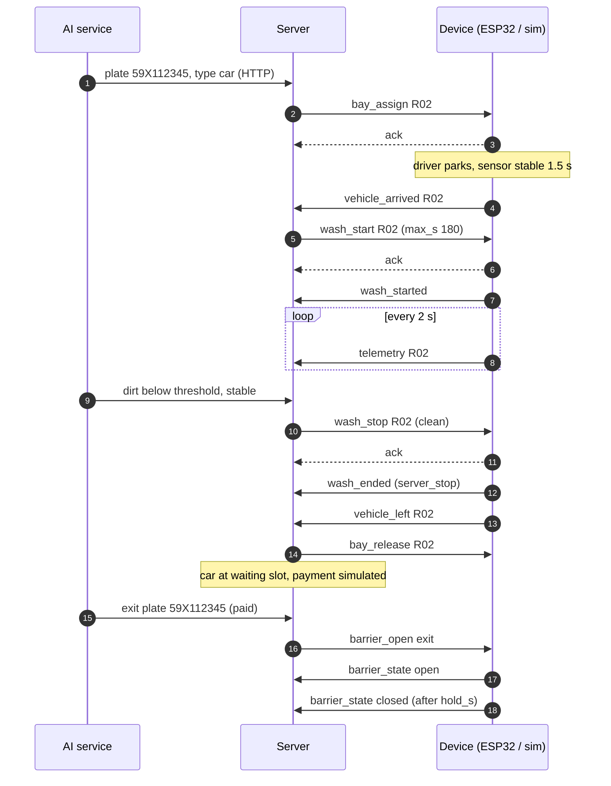

# WashingParking – Server ↔ Device Protocol (MQTT)

Version: **1** · Status: draft · Scope: prototype (cars only, bays `R01`–`R03`, exit barrier only, simulated payment)

This is the contract between the **server** (the "brain") and the **device** (ESP32 firmware, or the 3D demo acting as a virtual ESP32). Anything that speaks this protocol can stand in for the hardware.

## 1. Principles

- **Server decides, device executes and protects.** Business logic (orders, bay assignment, AI dirt threshold, payment) lives on the server. The device only drives outputs, reads sensors, and enforces local safety (max wash time, emergency stop, link-loss stop).
- **One ESP32 per station.** It controls all bays and the exit barrier. Bay is a field in the payload, not part of the topic.
- **Flat, small JSON.** Every message < 256 bytes, no nesting deeper than 2 levels, so it fits a fixed `StaticJsonDocument<256>` (ArduinoJson) on the ESP32.
- **Safety never depends on the network or the AI.** See §6.

## 2. Broker and connection

| Item | Value |
| --- | --- |
| Broker | Mosquitto (local PC / LAN) |
| Ports | `1883` MQTT/TCP (ESP32, server) · `9001` MQTT over WebSocket (browser demo, dashboard if needed) |
| Client ID | `<deviceId>` for devices (`esp01`, `sim01`), `server` for the server |
| Keep-alive | 15 s |
| Clean session | `true` (device re-syncs state after reconnect, see §6.3) |
| Last Will | topic `wp/<station>/<deviceId>/status`, payload `{"v":1,"type":"status","state":"offline"}`, QoS 1, **retained** |
| Auth | username/password per client (prototype); TLS out of scope |

## 3. Topics

Prefix: `wp/<stationId>/<deviceId>/` — prototype uses `stationId = st01`, `deviceId = esp01` (real board) or `sim01` (3D demo).

| Topic | Direction | QoS | Retained | Content |
| --- | --- | --- | --- | --- |
| `wp/st01/esp01/cmd` | server → device | 1 | no | Commands (§4.2) |
| `wp/st01/esp01/evt` | device → server | 1 | no | Events and command acks (§4.3) |
| `wp/st01/esp01/telemetry` | device → server | 0 | no | Periodic sensor values (§4.4) |
| `wp/st01/esp01/status` | device → server | 1 | **yes** | Heartbeat / online / offline (LWT) (§4.5) |

Server subscribes to `wp/st01/+/evt`, `wp/st01/+/telemetry`, `wp/st01/+/status`. Device subscribes only to its own `cmd`.

## 4. Messages

### 4.1 Envelope (all messages)

| Field | Type | Required | Notes |
| --- | --- | --- | --- |
| `v` | int | yes | Protocol version, `1` |
| `type` | string | yes | Message type (snake_case) |
| `id` | string | commands | Unique per command, ≤ 12 chars (e.g. `c000123`). Used for ack and de-duplication |
| `ref` | string | acks | `id` of the command being acknowledged |
| `seq` | uint32 | device msgs | Monotonic counter since boot; lets the server spot gaps / reboots |
| `up` | uint32 | device msgs | Device uptime in ms (`millis()`). ESP32 has no reliable wall clock; the server stamps receive time |
| `ts` | int64 | server msgs | Unix ms, server clock |

Common enums:

- `bay`: `"R01" | "R02" | "R03"`
- `gate`: `"exit"` (only one gate in v1)
- `scope` (e-stop): `"all"` or a bay id

### 4.2 Commands (server → device, topic `cmd`)

Every command gets exactly one `ack` event (§4.3). Server waits **3 s**, retries **once with the same `id`**, then marks the device as faulty for that action and alerts the dashboard.

#### `bay_assign` — bay assigned to a car
Device sets the bay LED/display to "reserved, drive in" and starts watching its presence sensor.
```json
{"v":1,"type":"bay_assign","id":"c000101","ts":1763000000000,"bay":"R02","plate":"59X112345"}
```

#### `wash_start` — start wash program
Sent only after `vehicle_arrived` for that bay. `max_s` is a hard limit the device enforces even if `wash_stop` never arrives.
```json
{"v":1,"type":"wash_start","id":"c000102","ts":1763000005000,"bay":"R02","order":"O0042","pressure_bar":100,"temp_c":35,"max_s":180}
```

#### `wash_stop` — end wash program
`reason`: `"clean"` (AI below threshold, stable) · `"min_time"` / `"timeout"` (server rules) · `"manual"` (staff).
```json
{"v":1,"type":"wash_stop","id":"c000103","ts":1763000120000,"bay":"R02","order":"O0042","reason":"clean"}
```

#### `bay_release` — bay free again
Device sets the bay LED to "free". Sent after `vehicle_left`.
```json
{"v":1,"type":"bay_release","id":"c000104","ts":1763000150000,"bay":"R02"}
```

#### `barrier_open` — open exit barrier
Sent after the server checks the exit plate is paid. Device auto-closes after `hold_s` **only if the gate sensor sees no car** (if it has one; otherwise purely by timer).
```json
{"v":1,"type":"barrier_open","id":"c000105","ts":1763000300000,"gate":"exit","hold_s":5}
```

#### `barrier_close` — close exit barrier now
```json
{"v":1,"type":"barrier_close","id":"c000106","ts":1763000303000,"gate":"exit"}
```

#### `display` — show guidance text on an LED/screen
`target`: `"entry"`, `"exit"` or a bay id. `color`: `"green" | "yellow" | "red" | "off"`. `text` ≤ 32 chars, ASCII (no diacritics, for cheap displays).
```json
{"v":1,"type":"display","id":"c000107","ts":1763000301000,"target":"exit","text":"PLEASE PAY","color":"red"}
```

#### `estop` — software emergency stop
Same effect as the physical button for the given scope.
```json
{"v":1,"type":"estop","id":"c000108","ts":1763000400000,"scope":"all","reason":"staff"}
```

#### `estop_reset` — clear emergency stop
Accepted **only if the physical e-stop button is released**; otherwise ack with `ok:false, err:"button_engaged"`. Reset does **not** resume washing; the server must send a new `wash_start`.
```json
{"v":1,"type":"estop_reset","id":"c000109","ts":1763000500000,"scope":"all"}
```

#### `sync` — ask device for full state
Device replies by publishing a `status` message immediately (plus the normal ack).
```json
{"v":1,"type":"sync","id":"c000110","ts":1763000600000}
```

### 4.3 Events (device → server, topic `evt`)

#### `ack` — command result
`err` codes: `"bad_json"`, `"unknown_type"`, `"bad_bay"`, `"busy"` (e.g. wash already running), `"no_vehicle"`, `"estop_active"`, `"button_engaged"`, `"link_lost"`.
```json
{"v":1,"type":"ack","ref":"c000102","seq":88,"up":503211,"ok":true}
```
```json
{"v":1,"type":"ack","ref":"c000102","seq":89,"up":503300,"ok":false,"err":"estop_active"}
```

#### `vehicle_arrived` — car in position in a bay
Debounced on device: presence stable for **1.5 s** within the target distance window.
```json
{"v":1,"type":"vehicle_arrived","seq":90,"up":510020,"bay":"R02","dist_cm":38}
```

#### `vehicle_left` — bay empty again
Debounced: no presence for **3 s**.
```json
{"v":1,"type":"vehicle_left","seq":97,"up":690400,"bay":"R02"}
```

#### `wash_started`
```json
{"v":1,"type":"wash_started","seq":91,"up":515100,"bay":"R02","order":"O0042"}
```

#### `wash_ended`
`reason`: `"server_stop"` · `"max_time"` (device hit `max_s`) · `"estop"` · `"link_lost"` · `"fault"`. `run_s` = actual run time.
```json
{"v":1,"type":"wash_ended","seq":95,"up":630000,"bay":"R02","order":"O0042","reason":"server_stop","run_s":115}
```

#### `barrier_state` — barrier actually moved
`state`: `"open" | "closed" | "blocked"` (close aborted because a car is under it).
```json
{"v":1,"type":"barrier_state","seq":120,"up":800200,"gate":"exit","state":"open"}
```

#### `estop` — emergency stop changed
`source`: `"button" | "server"`. Sent on activate (`active:true`) and on reset (`active:false`).
```json
{"v":1,"type":"estop","seq":130,"up":900000,"scope":"all","source":"button","active":true}
```

#### `fault` — hardware/sensor problem
`code` examples: `"sensor_timeout"`, `"relay_fail"`, `"barrier_stuck"`.
```json
{"v":1,"type":"fault","seq":131,"up":900500,"bay":"R01","code":"sensor_timeout"}
```

### 4.4 Telemetry (device → server, topic `telemetry`)

Every **2 s** while any bay is washing, every **10 s** otherwise. QoS 0 (loss is fine). One message per bay to stay small.
```json
{"v":1,"type":"telemetry","seq":92,"up":517000,"bay":"R02","dist_cm":38,"pump":1,"valve":1,"run_s":2}
```

### 4.5 Status / heartbeat (device → server, topic `status`, retained)

Published on connect, every **10 s**, on `sync`, and on any bay/e-stop state change. Retained, so the server (or dashboard) sees the latest state immediately after subscribing. The LWT overwrites it with `offline`.

`bays` is a compact string: one char per bay, in order `R01,R02,R03`: `F` free · `A` assigned · `O` occupied (car present) · `W` washing · `E` e-stop.
```json
{"v":1,"type":"status","state":"online","seq":93,"up":520000,"fw":"0.1.0","rssi":-61,"bays":"FAW","barrier":"closed","estop":false}
```
LWT (set at connect, sent by broker):
```json
{"v":1,"type":"status","state":"offline"}
```

## 5. Key flows



| Event | Order status transition (server, see `demo/logic.js`) |
| --- | --- |
| `bay_assign` sent | `WAITING_BAY` → `IN_BAY` (bay reserved) |
| `vehicle_arrived` | car in position → server sends `wash_start` |
| `wash_started` | `IN_BAY` → `WASHING` |
| `wash_ended` (`server_stop`) | `WASHING` → `WASHED` |
| `wash_ended` (`max_time` / `estop` / `link_lost` / `fault`) | stays `WASHING`, flagged **needs staff** on dashboard |
| `vehicle_left` | bay → `AVAILABLE`, order → `IN_WAITING_LOT` |
| `barrier_state open` at exit | `AT_EXIT` → `COMPLETED` |

## 6. Safety and failure handling

### 6.1 Emergency stop
- Physical button wired to the ESP32 **and** in series with the relay supply (hardware cut, not just firmware). Firmware also turns all outputs off within one loop iteration.
- Device publishes `estop {active:true}` and `wash_ended {reason:"estop"}` for each running bay.
- While active, the device rejects `wash_start` / `barrier_open` with `err:"estop_active"`.
- Clearing requires: button released **and** `estop_reset` from the server (staff action on the dashboard). Washing never auto-resumes.

### 6.2 Device side: link lost (Wi-Fi or broker down)
- After **10 s** without broker connection: stop all washes (store `wash_ended {reason:"link_lost"}` to send after reconnect), set bay LEDs to yellow "WAIT STAFF".
- Barrier: never opens without a server command. If already open, it finishes its normal `hold_s` close.
- Reconnect: exponential back-off 1 s → 30 s. On reconnect: publish `status`, then any queued `wash_ended`. Do not resume anything.

### 6.3 Server side: device lost
- Device is **offline** if `status.state == "offline"` (LWT) or no `status` for **30 s** (3 × heartbeat).
- Server stops assigning bays on that device, marks its bays **needs check** on the dashboard, holds pending exit-barrier opens for staff.
- On `online` again: server sends `sync`, compares `bays` with its own records, and lists mismatches for staff to resolve. No automatic resume.

### 6.4 Duplicates and ordering
- QoS 1 can deliver a command twice. Device remembers the last **8** command `id`s; a repeat gets the same ack again and is not executed twice.
- `seq` resets to 0 on reboot; the server treats a drop in `seq` as "device rebooted" and sends `sync`.

## 7. Virtual device (3D demo)

The demo connects to the broker over WebSocket (`ws://<host>:9001`) as `deviceId = sim01` and implements this protocol:
- subscribes to `wp/st01/sim01/cmd`, publishes `evt` / `telemetry` / `status` exactly as the ESP32 would;
- simulates sensors (car reaches bay → `vehicle_arrived`), outputs (wash animation, barrier mesh) and an on-screen e-stop button;
- uses `bays` R01–R03 (the demo's current B1–B3 maps to R01–R03; trucks, `C1` and the parking lot `P*`/`T*` are outside protocol v1).

Server code must not know whether `esp01` or `sim01` is on the other side.

## 8. Out of scope for v1

Trucks / motorbikes, VIP bay control, long-term parking, entry barrier, real payment, TLS, OTA firmware update, multiple stations.
